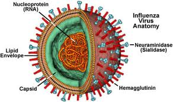
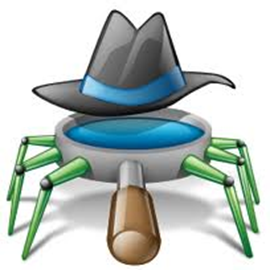
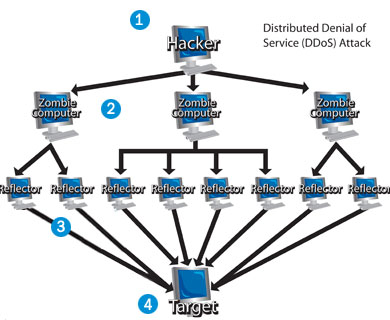
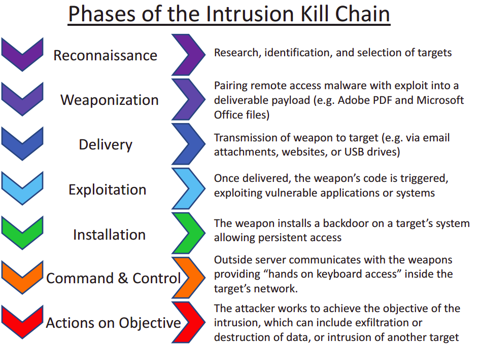

#+INCLUDE: "../../../common/header.org"
#+TITLE: Fraudes, intrusión y malware

* El origen del fraude

- Acción deliberada cuyo objetivo es perjudicar a alguien
- En seguridad informática atenta contra:
  - Confidencialidad
  - Integridad
  - Disponibilidad
- También puede perjudicar a las personas
  - En su ámbito moral o financiero

** Medios por los que llega un fraude

- Un mensaje
  - E-mail, redes sociales, chat, móvil
- Una página web
- Una intrusión directa de una persona
- La actuación de malware

** Los medios se combinan

- Mensaje + web
  - La mayoría de los fraudes por mensaje incluyen una dirección web
- E-mail + malware
  - El correo es una fuente habitual de propagación
- Malware + intrusión
  - El malware ayuda al intruso a “colarse”
- Todo ello se apoya a menudo en la *ingeniería social*

* Ingeniería social

- Obtener información confidencial manipulando usuarios legítimos
- Permite conseguir información, acceso o privilegios
- No requiere medios informáticos
  - Teléfono, en persona, correo...
- El usuario es el *eslabón débil* del sistema
- Se suplanta a alguien de confianza
  - Empleado de banco, compañero, técnico, cliente...

** ¿Por qué funciona?

- Explota la tendencia natural de las personas a confiar
- Provoca reacciones predecibles
- Evita tener que encontrar vulnerabilidades técnicas
- Ahorra procedimientos complejos y engorrosos

** Ejemplos

- /ClickFix/
- /Typosquatting/
- Falsas solicitudes de renovación de permisos
- Falsos avisos de bancos o redes sociales
- Correos que piden respuestas o dinero
- Cadenas de correo

* Los mensajes y la web

- Mensajes, web e ingeniería social están íntimamente ligados
- El e-mail y otras formas de mensajería son el origen y una herramienta más del fraude

** SPAM

#+ATTR_HTML: :style float:right;clear:both; :width 25%
#+attr_latex: :width 0.2\textwidth

- Correos que se reciben sin haberlos solicitado
- Remitente desconocido, falso o usurpado
- Mayoritariamente publicidad de productos dudosos
- También es el vehículo de otras estafas

** HOAXES

#+ATTR_HTML: :style float:right;clear:both; :width 25%
#+attr_latex: :width 0.2\textwidth

- Correos con contenido falso: “bulos” o “bromas”
- Suelen ser verosímiles y se propagan rápidamente
- Temas habituales:
  - Alertas sobre virus incurables
  - Temas solidarios, religiosos o de suerte
  - Leyendas urbanas
  - Fórmulas para hacerse millonario
  - Regalos de grandes compañías
- Objetivos:
  - Molestar o dañar la imagen de una compañía
  - Recopilar direcciones de correo

** Phishing

- /Password/ + /fishing/: “pescar contraseñas”
- El usuario entrega voluntariamente sus datos tras un engaño
- Ataque típico:
  1. E-mail que suplanta a un banco, ONG, red social...
  2. Enlace a una web falsa
  3. El usuario introduce sus credenciales
- El portal falso puede redirigir al auténtico para no ser detectado

** Malware por correo

- El e-mail y la mensajería son una fuente frecuente de malware
- Cualquier sistema de transferencia de ficheros puede propagarlo:
  - Páginas de descargas
  - BitTorrent, eMule...
  - Pendrives y discos extraíbles

** Las cifras del SPAM

- 2010
  - 107 billones de correos electrónicos
  - 89,1 % fueron SPAM
  - 1 de cada 284 contenía malware
  - 1 de cada 445 era phishing
- 2017: el SPAM baja al 55 %
- 2026: sigue siendo el mayor tipo de tráfico de e-mail
  - En torno al 45 % según la telemetría de Kaspersky

* Intrusiones por la red

- Intento deliberado de una persona de:
  - Acceder a información sin permiso
  - Alterar datos sin permiso
  - Impedir el acceso a los datos a sus usuarios legítimos
- Sin acceso físico al lugar donde está la información
- Compromete la confidencialidad, la integridad o la disponibilidad

** Ataque pasivo y ataque activo

- Si solo se compromete la *confidencialidad*
  - Ataque *pasivo*
- Si se compromete la *integridad* o la *disponibilidad*
  - Ataque *activo*
- La intrusión combina procedimientos manuales y automáticos
  - Malware + intrusión manual

** Niveles de actuación

- *Físico/enlace*
  - Interceptar el cable: requiere desplazamiento físico
  - Wi-Fi con poca protección: enlazarse o examinar tramas
- *Red/transporte*
  - Internet: interceptar o abrir un transporte remotamente
- *Aplicación*
  - Aprovechar vulnerabilidades de los protocolos de aplicación

** Perfiles de intruso

- Oportunista
  - Sin intención concreta: prueba a ver de qué es capaz
  - Comportamiento irregular y errático
- Profesional
  - Objetivo concreto y sin desviarse de él
  - Actúa con paciencia: recopila información, deduce, no deja huellas
  - Rápido y fulminante cuando ataca
- Objetivos idealistas o relacionados con el crimen organizado

** Herramientas del intruso

- Ingeniería social
- Malware
- Vulnerabilidades del software

* Amenazas por la red

- *Suplantación* (/spoofing/)
  - IP, DNS, ARP, e-mail, web...
- *Intromisión*
  - Acceso a servicios: phishing, fuerza bruta, diccionarios, code injection
- *Modificación*
  - Alteración de información tras una intromisión
- *Interceptación* (/hijacking/)
  - Desviar la información a otro destino

** Más amenazas

- *Espionaje* (/sniffing/)
  - Observar el tráfico para obtener información
- *Denegación de servicio* (DoS/DDoS)
  - Impedir el funcionamiento del servicio
  - Técnicas como la inundación (/flooding/)

* Técnicas de intrusión

- Comentamos las más habituales

** Spoofing o suplantación

- Suplantar la identidad en servicios de red
- *E-mail spoofing*: falsear el remitente y las cabeceras
- *DNS spoofing*: nombres falsos resueltos a una IP no legítima, o un DNS falso
- *IP spoofing*: sustituir la IP del remitente de un paquete
- *ARP spoofing*: tramas falsas que confunden la caché ARP
  - El switch o AP envía las tramas al atacante
- *DHCP spoofing*: servidor DHCP falso
  - Entrega una puerta de enlace o unos DNS falsos

** Sniffing y man in the middle

- *Sniffing*: “fisgar” el tráfico de la red
  - Conseguir datos para avanzar en la intrusión
- *Man in the middle*
  - Acceso a un punto intermedio de la comunicación
  - En cualquiera de los niveles de red
  - Normalmente mediante alguna técnica de /spoofing/
  - Permite hacer /sniffing/

* Vulnerabilidades del software

- Forma de usar un software que provoca un comportamiento anómalo
- Permite al intruso avanzar
- El software se diseña pensando en un uso predecible y regular
- Las situaciones no previstas son las vulnerabilidades
- Los desarrolladores parchean a medida que se descubren
  - Por eso hay que mantener todo actualizado

** Fuerza bruta y diccionario

- *Fuerza bruta*
  - Probar todas las combinaciones posibles de contraseñas
- *Ataque de diccionario*
  - Probar una lista de contraseñas comunes
  - Palabras del idioma, inglés, combinaciones, fechas
  - Nombres propios, artistas, lugares, marcas comerciales...

** Ataque fuzzy

- Probar los patrones más habituales para conseguir información
- Ejemplos:
  - URL terminada en =/admin= para acceder al backend
  - Código fuente en el directorio =.git=

** Code injection

- Conseguir que se ejecute código introduciéndolo en un lugar concreto
- El sistema ejecuta código que recibe por sus canales
- A veces acepta código en partes no previstas para ello
- Ejemplo: *SQL injection*
  - En el formulario de usuario y contraseña
  - Se logra ejecutar una orden SQL y obtener credenciales

** Hijacking

- Desviar una comunicación en marcha hacia un tercero
- El atacante pasa a ser el receptor final
- Muy frecuente el *secuestro de sesión*
  - Se intercepta la cookie con el identificador de sesión
  - Se continúa la sesión sin conocer la contraseña

** DoS y DDoS

- Enviar muchas peticiones falsas hasta colapsar el servicio
- Puede ser un colapso temporal o definitivo
- *DDoS*: varios atacantes simultáneamente
- Muy común hoy en día: peticiones HTTP a servidores web
- *Flooding*: inundar la red de peticiones

** Exploits

- Software que ayuda a vulnerar una medida de seguridad
- Aprovecha vulnerabilidades de los sistemas
- Ejemplos:
  - Herramientas para hacer DoS
  - Probadores de diccionarios
  - Criptoanálisis de tramas Wi-Fi
  - Código para SQL injection
  - Scripts para tomar el control del navegador
- Se diferencia del malware en que se distribuye manualmente
- *Metasploit* es el estándar de facto

** Zero day

- Vulnerabilidad no comunicada al fabricante
- No hay parche disponible
- Se aprovecha manualmente, con malware o con un exploit
- Especialmente peligrosa
  - Ni administradores ni antivirus están preparados

* La cultura de la intrusión

#+ATTR_HTML: :style float:right;clear:both; :width 20%
#+attr_latex: :width 0.15\textwidth

- Existe una “cultura hacker” o “movimiento hacker”
- Hay todo tipo de personas y es difícil clasificarlas
- Se necesita destreza y conocimientos técnicos
- Desde la seguridad, tan amenaza es el experto como el inexperto
- El logo es el /glider/ del “Juego de la vida”
  - Juego propuesto por John Horton Conway

** Terminología hacker

- *Black hat*
  - Intrusiones no autorizadas para perjudicar u obtener provecho
  - También llamados /crackers/
  - Programan /cracks/, /keygens/ u obtienen /serials/
- *White hat*
  - Dicen descubrir vulnerabilidades para informar a los propietarios
  - Una intrusión nunca es deseable, declare lo que declare el intruso
- *Script kiddie*: novato en la materia

* Malware

- /Malicious software/: código con intención maliciosa u oculta
- Vulnera confidencialidad, integridad o disponibilidad sin consentimiento
- Es malware por la intención de su autor
- Dos objetivos fundamentales:
  1. *Propagarse* al máximo número de máquinas y usuarios
  2. Realizar una *acción maliciosa*: el /payload/
     - Alterar el funcionamiento sin permiso ni conocimiento del usuario

** Clasificación por la forma de propagarse

- *Virus*: se une a software lícito
- *Gusano*: se duplica entero
- *Troyano*: se presenta como un programa legítimo
- Hoy es común combinar varias formas de propagación

** Virus

#+ATTR_HTML: :style float:right;clear:both; :width 25%
#+attr_latex: :width 0.2\textwidth

- Fragmento de código que no es un programa completo
- Modifica otros ejecutables para /inyectarse/ en ellos
- Al ejecutarse el programa infectado, el virus se ejecuta también
- Busca dónde duplicarse:
  - Ficheros =.exe=, =.dll=, sectores de arranque, drivers
  - Macros de Office, ficheros por lotes (BAT, SH)
- Ya son menos populares
  - Los binarios de Windows pueden estar firmados criptográficamente

** Virus: origen

#+ATTR_HTML: :style float:right;clear:both; :width 15%
#+attr_latex: :width 0.1\textwidth

- Término acuñado por *Fred Cohen* (1986)
- Desarrolló un programa que se propagaba por el sector de arranque de disquetes
- Su profesor era *Leonard Adleman* (la “A” de RSA)
- El virus de Cohen no llevaba /payload/

** Gusanos

#+ATTR_HTML: :style float:right;clear:both; :width 25%
#+attr_latex: :width 0.2\textwidth

- Se duplica entero; no altera ejecutables
- No “se pega” a otros programas
- Reside en memoria y se propaga por:
  - Servicios de red
  - Dispositivos de memoria secundaria
- No suele requerir intervención del usuario
- Necesita una vulnerabilidad para ser ejecutado en destino

** Gusanos: ejemplo

- Gusanos de pendrive
  - Se copian en el pendrive y alteran =autorun.inf=
  - Esperan que Windows los ejecute automáticamente
- En Linux
  - Crear un servicio de =systemd=
  - Modificar un fichero =cron=
- Gusanos de red
  - Usan protocolos de compartición de archivos
  - Aprovechan vulnerabilidades del sistema operativo destino

** Gusanos: Morris

- Primer gusano famoso: *Robert Morris* (1988)
- Se propagaba por una vulnerabilidad del envío de e-mail en sistemas Unix
- /Payload/: intentaba averiguar contraseñas
- Un fallo hizo que se replicase demasiado
  - Consumió memoria y causó denegaciones de servicio
- Infectó unas 6000 de las 60000 máquinas de Internet
- Pérdidas estimadas: 96 millones de dólares
- Fue declarado culpable

** Troyanos

#+ATTR_HTML: :style float:right;clear:both; :width 25%
#+attr_latex: :width 0.2\textwidth

- Se presenta como un programa legítimo e inofensivo
  - Juegos, utilidades, animaciones...
- Al ejecutarlo:
  - Realiza una acción encubierta (/payload/)
  - O inicia otro tipo de propagación
- El nombre viene del caballo de Troya de la Odisea

** El payload

- La carga puede pertenecer a varias categorías
- Ejemplos:
  - Spyware
  - Adware
  - Crimeware
  - Ransomware
  - Keyloggers y screenloggers
  - Mineros
  - Rootkits
  - Bots y RATs

** Spyware

#+ATTR_HTML: :style float:right;clear:both; :width 22%
#+attr_latex: :width 0.18\textwidth

- Recopila información sobre las actividades del ordenador
- Suele enviarla a empresas publicitarias u otras organizaciones
- Puede espiar:
  - Mensajes y contactos
  - Contraseñas
  - Datos de conexión: IP, DNS, teléfono, país
  - Webs visitadas y tiempo en ellas
  - Software instalado y descargas
  - Datos de formularios, tarjetas y cuentas bancarias

** Adware

#+ATTR_HTML: :style float:right;clear:both; :width 22%
#+attr_latex: :width 0.18\textwidth

- Propaga publicidad no deseada por canales no legítimos
- Ejemplos:
  - Ventanas emergentes
  - Sustituir la publicidad legítima por otra

** Crimeware

#+ATTR_HTML: :style float:right;clear:both; :width 22%
#+attr_latex: :width 0.18\textwidth

- Ayuda a enriquecerse ilícitamente a quien controla el software
- Ejemplos:
  - Formar parte de /botnets/ que atacan otros equipos
  - Servir de /proxy/ para mantener el anonimato

** Ransomware

- Secuestra la información del ordenador
  - Generalmente cifrando los ficheros del disco
- Envía la contraseña a un servidor de Internet
- Pide un rescate para recuperarla
- El pago suele ser en Bitcoins u otra moneda virtual
- El pago no garantiza recuperar los datos
- A veces la clave puede recuperarse del equipo infectado

** Keyloggers y screenloggers

#+ATTR_HTML: :style float:right;clear:both; :width 20%
#+attr_latex: :width 0.15\textwidth

- *Keylogger*: registra las pulsaciones de teclas
  - Espía documentación, datos confidenciales...
  - También existen por /hardware/, en el cable del teclado
- *Screenlogger*: captura la pantalla entera o partes
  - Actúa a petición o ante eventos, como pulsaciones de ratón
  - También existen por /hardware/

** Mineros

#+ATTR_HTML: :style float:right;clear:both; :width 18%
#+attr_latex: :width 0.13\textwidth

- Usan la potencia del equipo infectado para minar criptomonedas
- Beneficio para el intruso
- Minar requiere mucha potencia de cálculo
- A menudo el gasto energético supera el valor obtenido

** Rootkits

#+ATTR_HTML: :style float:right;clear:both; :width 22%
#+attr_latex: :width 0.18\textwidth

- Ocultan su presencia y la de otros programas
  - Procesos, archivos, directorios, claves de registro, puertos
- Permiten al intruso mantener el acceso remoto
- Corrompen el funcionamiento del sistema operativo
- Pueden ser la puerta de entrada de una intrusión o de más malware
- /Secure Boot/ dificulta su instalación
- Ejemplo: el gusano Conficker

** Bots y RATs

#+ATTR_HTML: :style float:right;clear:both; :width 22%
#+attr_latex: :width 0.18\textwidth

- *RAT* (/Remote Administration Tool/): administración remota
- Como /payload/ permite al intruso:
  - Capturar teclas o pantalla
  - Cambiar el registro
  - Escribir en memoria secundaria
  - Instalar programas
  - Realizar acciones de red...
- *BOT*: evolución del RAT
  - Además ejecuta scripts de instrucciones

** La “llamada a casa”

#+ATTR_HTML: :style float:right;clear:both; :width 18%
#+attr_latex: :width 0.13\textwidth

- RATs antiguos: escuchan en un puerto TCP/UDP
  - No funciona tras NAT/PAT: no hay ruta a la IP privada
- RATs modernos: /llamada a casa/
  - El malware abre un transporte hacia una IP pública
  - El router NAT/PAT permite la salida
  - El intruso utiliza una IP dinámica
  - El bot se conecta periódicamente a por instrucciones

** Botnets o “redes zombi”

#+ATTR_HTML: :style float:right;clear:both; :width 22%
#+attr_latex: :width 0.18\textwidth

- Conjunto de ordenadores infectados por un mismo /spybot/
- Son una fuerza bruta al servicio del intruso
- Los usuarios no son conscientes de ello
- Actividades más comunes:
  - Envío de SPAM
  - Ataques de denegación de servicio

* /Cyber kill chain/

- Los ataques pueden ser *no dirigidos*
  - Campañas masivas de SPAM
  - No importa demasiado a quién atacar
- O *dirigidos*
  - Objetivo concreto: empresa, centro de datos, persona
  - El ataque se profesionaliza
  - Se planifica en fases: la /cyber kill chain/
  - Cada fase tiene sus técnicas y herramientas

** Fases del ataque

#+ATTR_HTML: :width 70%
#+attr_latex: :width 0.6\textwidth

* Prevención

- Las medidas son muy variadas
- Hay tres puntos de especial incidencia:
  - Educación del usuario
  - El técnico informático
  - El antivirus

** Educación del usuario

- Instalar solo software de procedencia legítima y necesario
- Mantenerlo actualizado
- Desconfiar de cualquier mensaje que pueda ser falso
- Los servicios legítimos *nunca piden contraseñas* por correo
- Nunca seguir enlaces de avisos sorprendentes
- Contraseñas:
  - Longitud y complejidad adecuadas
  - Diferentes para cada servicio
  - Gestores de contraseñas y TOTP
- Evitar sistemas sensibles desde máquinas o redes desconocidas
  - Hotspots, ordenadores de uso público...
- Usar privilegios de usuario normal
- Avisar al administrador ante cualquier sospecha

** El técnico informático

- Menor nivel de permisos posible
- Permisos basados en /whitelist/, no en /blacklist/
- Datos en carpetas de red o sistemas de sincronización
- Copias de seguridad programadas
- Cambiar el orden de arranque: disco duro primero
- /Secure Boot/ contra /rootkits/
- Revisar políticas del sistema: Autoplay, etc.
- Antivirus actualizado y escaneos previos al arranque
- Auditorías de contraseñas
- Desactivar usuarios que ya no se usan
- Configurar bien la red y los enrutadores
  - Wi-Fi con la máxima seguridad
  - /Firewall/ y /proxy/ contra la “llamada a casa”

** El antivirus

- Imprescindible en todos los equipos conectados
- Busca trazas de malware conocido
  - En memoria secundaria, principal y comunicaciones
- Usa una base de datos de indicadores actualizada
- Formas de actuar:
  - Al vuelo: al ejecutar programas o insertar dispositivos
  - A propósito: por indicación del usuario
  - Durante el arranque: busca /rootkits/

* Conclusión

- Los fraudes e intrusiones existen: tarde o temprano seremos un objetivo
- El antivirus es casi imprescindible
- En la empresa, cuidar también:
  - La configuración de red
  - Evitar privilegios de administración para el trabajo diario
- La clave siempre es la *educación de los usuarios*

** INCIBE

- Instituto Nacional de Ciberseguridad
- Depende del Ministerio de Industria, Energía y Turismo
- [[https://incibe.es][incibe.es]]
- Fuente de información y concienciación
- [[https://www.incibe.es/incibe-cert/][INCIBE-CERT]], orientado al personal técnico:
  - Incidencias de seguridad en España
  - Formación y herramientas
  - Avisos de vulnerabilidades y actualizaciones

* Referencias

#+INCLUDE: "../../../common/footer.org"
