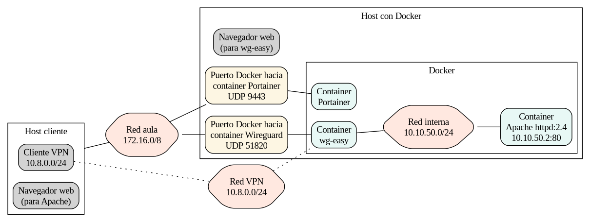

#+INCLUDE: "../../../common/header-examen-practica.org"

#+LATEX_HEADER: \lhead{Seguridad perimetral}
#+LATEX_HEADER: \rhead{Seguridad y Alta Disponibilidad}

#+TITLE: Práctica 03: Acceso a Apache únicamente a través de VPN con Docker y wg-easy

* Objetivo de la práctica

Tras la realización de esta práctica, el alumno será capaz de:

- Comprender el concepto de /seguridad perimetral/ y aislamiento de servicios.
- Crear y gestionar redes puente con /Docker/.
- Desplegar un servidor /Apache/ aislado, sin exposición directa al host.
- Desplegar un servidor /VPN/ con [[https://github.com/wg-easy/wg-easy][wg-easy]] para dar acceso remoto seguro.
- Verificar que un servicio solo es accesible a través del túnel /WireGuard/, quedando inaccesible desde el exterior sin VPN.

Está disponible la [[https://alvarogonzalezsotillo.github.io/apuntes-clase/seguridad-alta-disponibilidad/apuntes/3/sad-03-practica-wg-easy-apache-solo-vpn.pdf][última versión de esta práctica en este enlace]].

* Descripción del problema

Se desea que un servidor web /Apache/ solo accesible mediante una VPN.

Únicamente los clientes que se conecten al servidor /VPN/ levantado con /wg-easy/ podrán acceder a dicho servidor /Apache/.

Se expondrá al host el túnel /WireGuard/ (UDP 51820) y, la interfaz web de gestión de /wg-easy/ (TCP 51821).

El puerto 51820 será accesible desde el exterior. El puerto 51821 será solo accesible al host.

Se instalará Portainer en el host, para poder inspeccionar fácilmente los /containers/.

#+begin_src dot :file ./media/practica-vpn-con-containers.png :exports results :cmdline -Tpng
digraph{
    rankdir=LR;
    node [shape=box, style="rounded,filled"];
    edge [dir=none]
    compound=true
    splines=true

    subgraph cluster_maquinavirtual {
        label="Host con Docker";
        shape=box;

        puerto51820    [label="Puerto Docker hacia\ncontainer Wireguard\nUDP 51820", fillcolor="#fdf6e3"];
        puerto9443    [label="Puerto Docker hacia\ncontainer Portainer\nUDP 9443", fillcolor="#fdf6e3"];

        
        subgraph cluster_docker{
            label="Docker"
            portainer [label="Container\nPortainer" fillcolor="#e8f8f5"];
            apache  [label="Container\nApache httpd:2.4\n10.10.50.2:80" fillcolor="#e8f8f5"];
            redinterna  [label="Red interna\n10.10.50.0/24", shape=hexagon, fillcolor="#ffe8e0"];
            wireguard  [label="Container\nwg-easy" fillcolor="#e8f8f5"];
        }
    }

    redaula  [label="Red aula\n172.16.0/8", shape=hexagon, fillcolor="#ffe8e0"];
    
    puerto9443 -> portainer;
    
    cliente [label="Cliente VPN\n10.8.0.0/24", fillcolor="#fdf6e3"];

    cliente -> redaula -> puerto51820;
    redaula -> puerto9443;
    puerto51820    -> wireguard -> redinterna  -> apache

    cliente -> redvpn -> wireguard [style=dotted]

    redvpn  [label="Red VPN\n10.8.0.0/24", shape=hexagon, fillcolor="#ffe8e0"];

}
#+end_src

#+RESULTS:

* Requisitos

- Equipo host con /Docker/ instalado, para los servidores (máquina virtual)
  - Con interfaz gráfica para acceder a Portainer
  - Permisos para crear redes, contenedores y modificar =sysctl= (root)
- Equipo con interfaz gráfica donde instalar el cliente de VPN (máquina virtual).
  - Windows, o bien
  - Linux con KDE (Gnome debería servir, pero no está probado por el profesor)
- Conexión a Internet para descargar las imágenes
  - =docker.io/weejewel/wg-easy:latest=
  - =docker.io/library/httpd:2.4=.

* Pasos a seguir

Orientativamente, puedes seguir estos pasos:
1. *Docker.* La forma más fácil es con el [[https://docs.docker.com/engine/install/ubuntu/#install-using-the-convenience-script][/script/ de conveniencia]] en una máquina virtual linux.
2. *Portainer.* (opcional) [[https://docs.portainer.io/start/install-ce/server/docker/linux][Se utilizará la /comunity edition/]]. Puede ayudar a crear containers y a inspeccionar el estado de Docker.
3. *Creación de red interna.* [[https://docs.docker.com/reference/cli/docker/network/create/][Crea la red interna]] /Docker/ donde conectar el servidor web y el servidor VPN.
4. *Despliegue de Apache.* Despliega un contenedor con [[https://hub.docker.com/_/httpd][=httpd:2.4=]].
   - Conéctalo [[https://stackoverflow.com/a/35359185][únicamente a la red interna y con una ip]] concreta.
   - Crea una página =index.html= personalizada en un [[https://hub.docker.com/_/httpd#without-a-dockerfile][volumen conectado al directorio raiz de Apache]].
5. *Despliegue de wg-easy.* Despliega el [[https://hub.docker.com/r/weejewel/wg-easy][contenedor =wg-easy=]]
   - Conecta el puerto 51820 UDP al host
   - Conecta el puerto 51821 TCP al host, [[https://stackoverflow.com/a/22100687][pero solo accesible desde el propio host]]
   - Conéctalo también a la red interna.
   - [[https://hub.docker.com/r/weejewel/wg-easy#2-run-wireguard-easy][Habilita el reenvío IP y configura los parámetros necesarios]] para que los clientes VPN puedan alcanzar la subred interna.
   - Haz un volumen en =/etc/wireguard= dentro del container, o los usuarios que crees podrían perderse.  
6. *Configuración del cliente VPN.* Desde el panel web de /wg-easy/ (puerto 51821, con un navegador), crea un cliente /WireGuard/, descarga su configuración o código QR y conéctalo.
7. *Comprobación del aislamiento.* Comprueba que sin estar conectado a la VPN no se accede a /Apache/ y, con la VPN activa, sí se accede mediante la IP del contenedor /Apache/ desde el cliente VPN.

* Solución :noexport:

#+begin_src bash
sudo docker network create red-interna \
  --driver bridge \
  --subnet 10.10.50.0/24
#+end_src

#+begin_src bash
mkdir -p ~/practica-vpn-apache/html

cat > ~/practica-vpn-apache/html/index.html << 'EOF'
<html>
  <head>
    <title>Acceso solo por VPN</title>
    <meta http-equiv="Content-Type" content="text/html; charset=utf-8">
  </head>
  <body>
    <h1>¡Éxito!</h1>
    
Solo puedes ver esta página si estás conectado por WireGuard

  </body>
</html>
EOF
#+end_src

#+begin_src bash
sudo docker run -d \
  --name apache \
  --hostname apache \
  --network red-interna \
  --ip 10.10.50.2 \
  -v ~/practica-vpn-apache/html:/usr/local/apache2/htdocs/:Z \
  docker.io/library/httpd:2.4
#+end_src

Definimos las variables. Sustituye =192.168.1.100= por la IP del host que utilizarán los clientes VPN para conectar.

#+begin_src bash
export HOST_IP="192.168.1.100"
export WG_PASS="Asir1234"

mkdir -p ./etc_wireguard
sudo docker run -d \
  --name wg-easy \
  --hostname wg-easy \
  --cap-add=NET_ADMIN \
  --sysctl net.ipv4.ip_forward=1 \
  --sysctl net.ipv4.conf.all.src_valid_mark=1 \
  -e WG_HOST=192.168.56.113 \
  -e PASSWORD=secreto \
  -e WG_PORT=51820 \
  -e WG_DEFAULT_ADDRESS=10.8.0.x \
  -e WG_DEFAULT_DNS=1.1.1.1 \
  -e WG_ALLOWED_IPS="10.8.0.0/24, 10.10.50.0/24" \
  -e WG_PERSISTENT_KEEPALIVE=25 \
  -p 51820:51820/udp \
  -p 127.0.0.1:51821:51821/tcp \
  -v ./etc_wireguard:/etc/wireguard \
  --network red-interna \
  docker.io/weejewel/wg-easy:latest
#+end_src

* Qué se valorará

Se entregará un documento (=PDF=, =ODT=, =DOCX=) con la siguiente información:

- *Topología:* Diagrama con las redes, contenedores y flujo de tráfico.
- *Despliegue:* Comandos utilizados para crear redes, lanzar contenedores y conectar containers redes.
- *Configuración VPN:* Captura del panel web de /wg-easy/ con el cliente creado y/o captura del cliente /WireGuard/ conectado.
- *Comprobaciones:* Mostrando la página personalizada de /Apache/.
- *Claridad y presentación:* Pasos ordenados, explicaciones razonadas y capturas legibles.

* Instrucciones de entrega
- *Modalidad:* Individual. Solo se admitirá en pareja si así se indica expresamente en clase.
- *Lugar de entrega:* Tarea correspondiente a esta práctica en el aula virtual del módulo.

