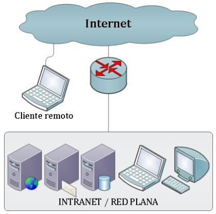
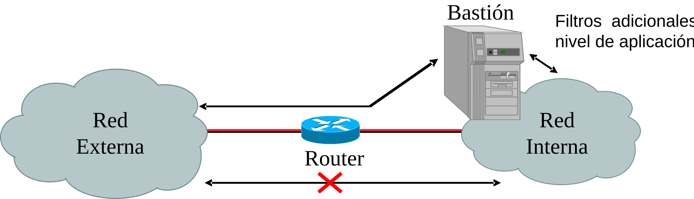
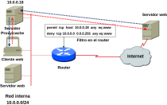
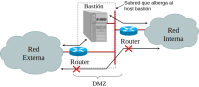

#+INCLUDE: "../../../common/header.org"
#+TITLE: Seguridad perimetral

* Introducción

- Las redes corporativas son LAN
  - Se asumen privadas
  - El administrador controla clientes, servicios, equipos de red
  - Pero es una red aislada
- Redes públicas
  - Tienen una utilidad evidente: consumir y proveer servicios a otras empresas o divisiones de la empresa
  - Tienen peligros evidentes: ataques a sistemas internos  

* Sin seguridad perimetral

- Se conecta la red corporativa a Internet mediante un router
- Sin /firewall/, simplemente enrutamiento
  - Publicación de servicios internos
  - No hay elementos de monitorización
  - No se filtra tráfico de entrada ni de salida
  - Clientes remotos acceden directamente a los servicios.
    

* Seguridad perimetral

- La primera línea de defensa entre las redes públicas y privadas.  ◦
- La seguridad perimetral implementa diferentes tipos de arquitectura
- Para proteger nuestra /red interna/ o /subred protegida/.
- Hay varias posibilidades, que varían entre:
  - Configuración sencilla y poca protección. *Débil*
  - Configuración compleja y alta protección. *Fuerte*

* Medidas a a aplicar
- La seguridad perimetral puede combinar varias medidas entre:
  - Cortafuegos (/firewall/) en /routers/
  - Cortafuegos en equipos finales (servidores)
  - Bastiones (/proxies/ o pasarelas)
  - [[https://alvarogonzalezsotillo.github.io/apuntes-clase/planificacion-administracion-redes-asir1/apuntes/8/par-8-vpn.reveal.html][VPN]]

    
* /Firewall/
- Trabaja generalmente a nivel de red (IP) y transporte (TCP, UDP)
- Tipos
  - /firewalls/ personales: integrados en las /workstations/ y servidores
    - [[https://costales.github.io/projects/gufw/][ufw]]
    - [[https://learn.microsoft.com/en-us/windows/security/operating-system-security/network-security/windows-firewall/][Windows firewall]]   
  - /Firewalls/ por /software/
    - Se instalan en sistemas operativos de servidor
    - Utilizan las mismas tecnologías que los /firewalls/ personales, con extensiones para varias interfaces
  - /Firewalls/ por /hardware/   
    - Instalados en equipos de red (no terminales)
    - Ejemplo: [[https://alvarogonzalezsotillo.github.io/apuntes-clase/planificacion-administracion-redes-asir1/apuntes/7/par-7-acl-cisco.reveal.html][ACL de Cisco]]

** /Firewalls/ más allá de TCP/UDP
- Los bastiones (más adelante) pueden incluir reglas de acceso
- Puede haber configuraciones/plugins en servidores que cumplan función de filtro
  - Ejemplo: [[https://modsecurity.org/docs/index.html][modsecurity]] para Apache/ISS/nginx//

* /Proxy/ (pasarela)
- Equivalente a bastión
  - El bastión suele ser el servidor, el /proxy/ el servicio
  - El bastión puede hacer funciones de /router/  
- El /proxy/ hace de [[https://en.wikipedia.org/wiki/Man-in-the-middle_attack][MITM]] entre los clientes y los servicios reales
  a) El cliente está configurado para usar el /proxy/
  b) O bien el administrador de red ha configurado los DNS/routers para hacer creer al cliente que se comunica con el servicio ([[https://es.wikipedia.org/wiki/Servidor_proxy#Proxies_transparentes][/proxy/ transparente]])

* Arquitecturas de cortafuegos
- /Screening router/
- /Screened host/
- /Screened subnet/

** /Screening router/
- Configuración simple
- Poco /hardware/ (barato)
- Los servicios al exterior están en la misma red que las /workstations/
  - Se mezcla tráfico interno y externo en la misma red /ethernet/  
- La seguridad depende de un solo punto
  - Si un atacante consigue el control del router, controla toda la red   
   
file:media/screening-router.svg

#+reveal: split
- El /router/ puede cambiarse por un bastión
- Así puede controlarse también el nivel de aplicación
- Filtros más complejos, con más criterios
  - Usuario de aplicación
  - Recurso accedido (URL)
  - Límites de ancho de banda y tráfico total  
  - Hora y día de acceso
  - ...  

** /Screened host/
- Se separa el /router/ del bastión
- El /router/ envía las peticiones externas al bastión
- La mayoría de los clientes no salen directamente por el router, sino que lo hacen a través del bastión    

#+reveal: split
- Ejemplo con /router/ Cisco, en el que todas las peticiones HTTP deben pasar por el /proxy/

** /Screened subnet/
- La red interna no se satura con peticiones del exterior
- Si el router externo o el bastión es /hackeado/ queda otro nivel de protección
- Más caro, más complejo. Pero más difícil de comprometer.  

** DMZ
- Los servicios al exterior no necesitan estar en la red interna
- Suelen colocarse entre los dos /routers/
  
