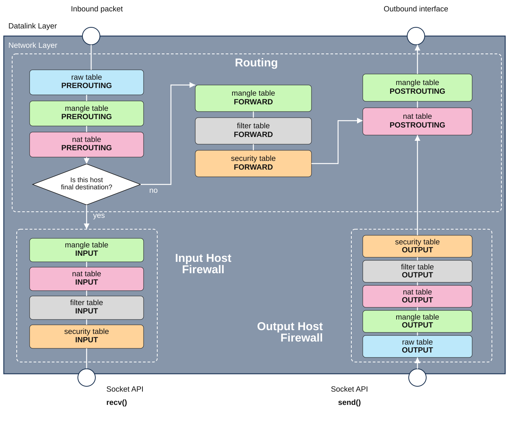

#+INCLUDE: "../../../common/header.org"
#+TITLE: Cortafuegos (/firewall/)

* Introducción
- Un /firewall/ es cualquier sistema que filtre paquetes de datos
- Conocemos las [[https://alvarogonzalezsotillo.github.io/apuntes-clase/planificacion-administracion-redes-asir1/apuntes/7/par-7-acl-cisco.reveal.html][ACL de cisco del año pasado]]
- Este año trabajaremos [[https://netfilter.org/][Netfilter]] (linux)  
  
  
* Netfilter
- Es el módulo de linux encargado de filtrar paquetes
- *iptables*
  - Interfaz más antigua (2001)
  - Soportada por /kernels/ y programas antiguos (por ejemplo, Docker)
- *nftables*
  - Interfaz actual (2014)
  - Necesita /kernels/ más modernos (3.13)
  - Se pueden utilizar comandos similares a /iptables/ que trabajen sobre /nftables/
  - Ventajas: más eficiente en algunos casos, más fácil de configurar  
- Conclusión para este curso:
  - Se usarán /iptables/, ya que son compatibles con todos los sistemas

* IPTables: visión general
- Tabla: Aproximadamente, qué se puede filtrar y qué acciones se pueden aplicar
- Cadena: Aproximadamente, el momento en el que se aplican las reglas
    

Basado en: [[https://yuta-san.medium.com/network-basics-related-to-wifi-hosting-2-2-packet-processing-in-linux-6771d09eb458][Yuta Fujii]]

** Orden de las reglas
- Las reglas se procesan en orden
  1. Se comprueba si el paquete encaja con la regla
  2. Si encaja, se aplica la acción. Si la acción rechaza el paquete, ya no se siguen mirando reglas
  3. Si no encaja, se pasa a la siguiente regla      
- Unas reglas pueden /esconder/ a otras
  - Una regla que acepta un paquete hace que las reglas siguientes que lo rechazaban no se alcancen
- Si el paquete no encaja con ninguna regla se aplica la acción por defecto de la cadena

* Comando =iptables=

#+begin_src bash
iptable -t TABLA [OPERACION] CADENA [REGLA Y PARAMETROS] [ACCION]
#+end_src

- El orden de ejecución es importante, por defecto las reglas se añaden al final
  
** tablas y cadenas
#+begin_src bash
iptable -t TABLA [OPERACION] CADENA [REGLA Y PARAMETROS] [ACCION]
           =====             ======
#+end_src

|                  | =PREROUTING= | =INPUT= | =FORWARD= | =OUTPUT= | =POSTROUTING= |
|------------------+--------------+---------+-----------+----------+---------------|
| Tabla =raw=      | 1º           | -       | -         | 1º       | -             |
| Tabla =mangle=   | 2º           | 1º      | 1º        | 2º       | 1º            |
| Tabla =nat=      | 3º           | 2º      | -         | 3º       | 2º            |
| Tabla =filter=   | -            | 3º      | 2º        | 4º       | -             |
| Tabla =security= | -            | 4º      | 3º        | 5º       | -             |

Nota: Si no se especifica una tabla, se usa la tabla =filter=

** Operación
#+begin_src bash
iptable -t TABLA [OPERACION] CADENA [REGLA Y PARAMETROS] [ACCION]
                 ===========
#+end_src

| =-A= | Agregar nueva regla                         |
| =-I= | Insertar nueva regla                        |
| =-R= | Reemplazar la regla (rulenum)               |
| =-E= | Modifica el nombre de la cadena.            |
| =-L= | Listado de reglas de la cadena especificada |
| =-N= | Crear nueva cadena asociándola a un nombre. |
| =-P= | Modifica la acción por defecto de la cadena |
| =-D= | Elimina una regla de la cadena              |
| =-Z= | Reinicia los contadores de la cadena        |
| =-F= | Borra todas las reglas de una tabla         |

** Regla y parámetros

| =-i=      | Interfaz de entrada ( =lo= , =eth0=, ...) |
| =-o=      | Interfaz de salida                       |
| =--sport= | Puerto de origen                         |
| =--dport= | Puerto de destino                        |
| =-s=      | IP/red de origen                         |
| =-d=      | IP/red de destino                        |
| =-p=      | Protocolo (=tcp=, =udp=, =icmp=, =all=)  |
| =-j=      | Para especificar la acción               |

*** Ejemplos
#+begin_src bash
# 1. Todo el tráfico TCP dirigido al equipo está permitido, por todas las interfaces
iptables -A INPUT -p tcp -j ACCEPT

# 2. Rechazar conexiones SSH
iptables -A INPUT -p tcp --dport 22 -j REJECT

# 3. Aceptar SSH desde una IP de origen concreta
iptables -A INPUT -p tcp -s 192.168.1.50 --dport 22 -j ACCEPT

# 4. HTTPS está disponible desde una red
iptables -A INPUT -p tcp -s 192.168.1.0/24 --dport 443 -j ACCEPT

# 5. UDP dirigido al puerto 53
iptables -A INPUT -p udp --dport 53 -j ACCEPT

# 6. ICMP entrante por una interfaz concreta
iptables -A INPUT -i eth0 -p icmp -j ACCEPT

# 7. Tráfico que entra por eth0, desde una red concreta,
#    dirigido a un servidor interno en el puerto 80
iptables -A FORWARD -i eth0 -p tcp -s 198.51.100.0/24  -d 192.168.1.10 --dport 80 -j ACCEPT

# 8. Tráfico TCP que sale por eth0 hacia un destino concreto,
#    desde una IP local y con puerto de origen 50000
iptables -A OUTPUT -o eth0 -p tcp -s 192.168.1.20  -d 203.0.113.25 --sport 50000 --dport 443 -j ACCEPT

#+end_src

** Acción
#+begin_src bash
iptable -t TABLA [OPERACION] CADENA [REGLA Y PARAMETROS] [ACCION]
                                                         ========
#+end_src
- =ACCEPT= : Paquete aceptado.
- =REJECT= : Paquete rechazado. Envía notificación ICMP.
- =DROP= : Paquete rechazado. Sin notificación.
- =MASQUERADE= : Enmascaramiento de la dirección IP origen de forma dinámica.
  - Solo es válida en la tabla NAT cadena POSTROUTING.
- =DNAT= : Enmascaramiento de la dirección de destino.
- =SNAT= : Enmascaramiento de la dirección IP de origen.
- =REDIRECT= : Cambia IP de destino por /host/ local
- =LOG= : Se crea un registro =syslog= del paquete
- =NOTRACK= : El paquete deja de usarse en el módulo =conntrack=  

*** Diferentes NAT
| Target       | Qué cambia                                                              | Uso habitual                                        | Cadena común           |
|--------------+-------------------------------------------------------------------------+-----------------------------------------------------+------------------------|
| =SNAT=       | IP/puerto *origen*                                                      | Tráfico saliente con una IP pública fija            | =POSTROUTING=          |
| =MASQUERADE= | IP/puerto *origen*, usando la dirección actual de la interfaz de salida | Tráfico saliente con IP dinámica, por ejemplo, DHCP | =POSTROUTING=          |
| =DNAT=       | IP/puerto *destino*                                                     | Redirigir puertos a un servidor interno             | =PREROUTING=           |
| =REDIRECT=   | IP/puerto *destino*, siendo el destino el host local                    | Redirigir puertos en el mismo /host/                | =PREROUTING=, =OUTPUT= |
  
*** Ejemplos NAT
#+begin_src bash
# SNAT: cambiar la IP de origen por una IP pública fija
iptables -t nat -A POSTROUTING -o eth0 -s 192.168.1.0/24 -j SNAT --to-source 203.0.113.10

# MASQUERADE: usar automáticamente la IP actual de eth0
iptables -t nat -A POSTROUTING -o eth0 -s 192.168.1.0/24 -j MASQUERADE

# DNAT: redirigir conexiones entrantes al puerto 8080 del servidor interno
iptables -t nat -A PREROUTING -i eth0 -p tcp --dport 80 -j DNAT --to-destination 192.168.1.10:8080

# REDIRECT: redirigir conexiones al puerto 80 hacia el puerto 8080 local
iptables -t nat -A PREROUTING -i eth0 -p tcp --dport 80 -j REDIRECT --to-ports 8080
#+end_src

*** Ejemplos LOG

#+begin_src bash
# Registrar paquetes ICMP entrantes por eth0
iptables -A INPUT -i eth0 -p icmp -j LOG

# Añadir un prefijo para reconocerlos en el registro
iptables -A INPUT -i eth0 -p icmp  -j LOG --log-prefix "ICMP-entrada: "

# Registrar conexiones TCP nuevas al puerto 22 y luego bloquearlas
iptables -A INPUT -p tcp --dport 22 -m conntrack --ctstate NEW -j LOG --log-prefix "SSH-inicio: "
iptables -A INPUT -p tcp --dport 22 -m conntrack --ctstate NEW -j DROP

# Registrar conexiones al puerto 80, pero 5 por minuto de media, con un límite fuerte de 10 de golpe
iptables -A INPUT -p tcp --dport 80 -m conntrack --ctstate NEW -m limit --limit 5/min --limit-burst 10 -j LOG --log-prefix "HTTP-inicio: "
#+end_src

* =conntrack=
| ~--ctstate~ | Significado del paquete                                                                | Uso                                                 |
|-------------+----------------------------------------------------------------------------------------+-----------------------------------------------------|
| NEW         | inicia una conexión nueva o aún no se reconoce como parte de una conexión establecida. | Permitir conexiones nuevas a un servidor .          |
| ESTABLISHED | pertenece a una conexión ya establecida.                                               | Permitir respuestas a conexiones iniciadas.         |
| RELATED     | una conexión nueva relacionada con otra conexión existente.                            | Algunos errores ICMP relacionados con una conexión. |
| INVALID     | no se puede asociar correctamente a una conexión conocida.                             | Registrar o descartar paquetes inesperados.         |
| UNTRACKED   | excluido explícitamente del seguimiento de conexiones.                                 | Tráfico marcado con reglas `NOTRACK`.               |

* Herramientas para depuración de reglas
- Inicio típico de iptables
  - Borrado de tablas (en el ejemplo, solo =filter=)
  - Definición de políticas por defecto  
  #+begin_src bash
  iptables -F # borra todas las reglas y cadenas de la tabla filter
  iptables -X # borra también cadenas personalizadas 
  iptables -Z # reinicia los contadores
  iptables -P INPUT DROP # por defecto, filter acepta paquetes de entrada
  iptables -P OUTPUT ACCEPT # el tráfico saliente está permitido por defecto
  iptables -P FORWARD REJECT # por defecto, se informa de que no se enrutan paquetes 
  #+end_src
- Listado de reglas de una cadena, con número de paquetes a los que se aplica
  #+begin_src bash
  iptables --list INPUT --numeric --verbose
  #+end_src
- Listado de todas las reglas
  #+begin_src bash
  iptables-save
  #+end_src  
- Herramientas habituales de red
  - =tcpdump= o =wiresark=
  - =mtr= o =tracert=
  - =nc= o =socat=  

* Cadenas definidas por el usuario
- Se pueden utilizar para organizar un gran número de reglas
- Ejemplo: cadenas que añade =docker=
- Ejemplo: Los paquetes de =INPUT= (=filter=) se envían a =WEB=. Si no se aplica allí ninguna regla vuelven a =INPUT=
  #+begin_src bash
  iptables -N WEB
  iptables -A WEB -p tcp --dport 80 -j ACCEPT
  iptables -A WEB -p tcp --dport 443 -j ACCEPT
  iptables -A INPUT -j WEB
  #+end_src
  
* Referencias
#+INCLUDE: "../../../common/footer.org"
