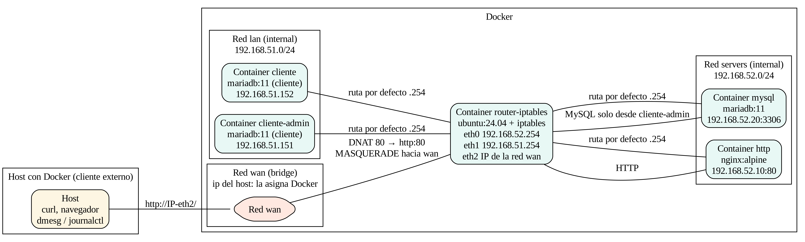

#+INCLUDE: "../../../common/header-examen-practica.org"

#+LATEX_HEADER: \lhead{Seguridad perimetral}
#+LATEX_HEADER: \rhead{Seguridad y Alta Disponibilidad}

#+TITLE: Práctica 04: Cortafuegos con iptables en una topología Docker

#+OPTIONS: author:nil date:nil toc:t

* Objetivo de la práctica

Tras la realización de esta práctica, el alumno será capaz de:

- Comprender la diferencia entre el tráfico =INPUT=, =OUTPUT= y =FORWARD= en un /firewall/ Linux.
- Desplegar con /Docker Compose/ una topología con tres redes: una red externa (=wan=) y dos redes aisladas (=servers= y =lan=).
- Publicar un servicio interno hacia la red externa mediante =NAT=.
- Aplicar políticas por defecto restrictivas y reglas de excepción para permitir únicamente el tráfico autorizado.
- Restringir el acceso a un servicio (=MySQL=) a un único cliente, e identificar las reglas =LOG= que registran el resto de intentos.
- Verificar el aislamiento de las redes, interpretar las tablas de =iptables= y localizar los mensajes del cortafuegos en el log del kernel del host.

Está disponible la [[https://alvarogonzalezsotillo.github.io/apuntes-clase/seguridad-alta-disponibilidad/apuntes/4/sad-04-practica-iptables-docker.pdf][última versión de esta práctica en este enlace]].

* Descripción del problema

Se entrega el directorio =plantilla-practica/= con el escenario ya preparado.

*docker compose* crea los contenedores y redes necesarias. Cada contenedor ejecuta al inicio un fichero =setup.sh= propio.

*La práctica se puede realizar completando los ficheros =setup.sh=.* No hay que modificar el =docker-compose.yml=, los =Dockerfile=, el =.env= ni la página =index.html=.

El comportamiento será el siguiente:
- Filtro /whitelist/: todo está prohibido, pero se permiten algunas cosas.
- Desde la red =wan= se puede acceder al servidor /HTTP/, en el puerto 80 del host.
- Desde la red =lan= (todos los containers presentes y futuros), se puede acceder a =http= por HTTP y hacer =ping= a la red =servers=.
- Desde la red =lan=, *solo* =cliente-admin= puede conectarse a =mysql= por el puerto 3306.
- Cualquier otro tráfico que atraviese el router se descarta y queda registrado en el log.
- Ningún contenedor de =servers= o =lan= tiene salida directa al exterior: sus rutas por defecto apuntan al router, que es el único paso entre redes.

Ejemplos de funcionalidad no permitida
- Desde =wan= se puede hacer /ping/ a algún container
- Los servidores pueden hacer /ping/ a ordenadores de otra red
    

#+begin_src dot :file ./media/practica-04-topologia-docker.png :exports results :cmdline -Tpng
digraph{
    dpi=600;
    rankdir=LR;
    node [shape=box, style="rounded,filled"];
    edge [dir=none]
    compound=true
    splines=true

    subgraph cluster_host {
        label="Host con Docker (cliente externo)";
        shape=box;
        host [label="Host\ncurl, navegador\ndmesg / journalctl", fillcolor="#fdf6e3"];
    }

    subgraph cluster_maquinavirtual {
        label="Docker";
        shape=box;

        router [label="Container router-iptables\nubuntu:24.04 + iptables\neth0 192.168.52.254\neth1 192.168.51.254\neth2 IP de la red wan", fillcolor="#e8f8f5"];

        subgraph cluster_wan {
            label="Red wan (bridge)\nip del host: la asigna Docker";
            shape=hexagon;
            redwan [label="Red wan", shape=hexagon, fillcolor="#ffe8e0"];
        }

        subgraph cluster_servers {
            label="Red servers (internal)\n192.168.52.0/24";
            shape=hexagon;
            http  [label="Container http\nnginx:alpine\n192.168.52.10:80", fillcolor="#e8f8f5"];
            mysql [label="Container mysql\nmariadb:11\n192.168.52.20:3306", fillcolor="#e8f8f5"];
        }

        subgraph cluster_lan {
            label="Red lan (internal)\n192.168.51.0/24";
            shape=hexagon;
            admin   [label="Container cliente-admin\nmariadb:11 (cliente)\n192.168.51.151", fillcolor="#e8f8f5"];
            cliente [label="Container cliente\nmariadb:11 (cliente)\n192.168.51.152", fillcolor="#e8f8f5"];
        }
    }

    host -> redwan [label="http://IP-eth2/"];
    redwan -> router [label="DNAT 80 → http:80\nMASQUERADE hacia wan"];
    router -> http [label="HTTP"];
    router -> mysql [label="MySQL solo desde cliente-admin"];
    admin -> router [label="ruta por defecto .254"];
    cliente -> router [label="ruta por defecto .254"];
    http -> router [label="ruta por defecto .254"];
    mysql -> router [label="ruta por defecto .254"];
}
#+end_src

#+RESULTS:

* Requisitos

- Máquina virtual con /Docker/ y /Docker Compose/ instalados, con permisos para construir imágenes, crear redes y modificar =sysctl=.
- Para ver los mensajes de =iptables -j LOG= hay que desactivar en el host la opción que oculta los logs procedentes de otros espacios de nombres de red:
  #+begin_src bash
  sudo sysctl -w net.netfilter.nf_log_all_netns=0
  #+end_src

* Qué se valorará

Se entregará un documento (=PDF=, =ODT= o =DOCX=) con la siguiente información:

- *Despliegue:* comandos utilizados y explicación de qué hace cada =setup.sh= y cuándo se ejecuta.
- *Claridad y presentación:* pasos ordenados y explicaciones propias.
- El profesor también realizará una comprobación del funcionamiento en el día indicado.

* Instrucciones de entrega

- *Modalidad:* individual. Solo se admitirá en pareja si así se indica expresamente en clase.
- *Lugar de entrega:* tarea correspondiente a esta práctica en el aula virtual del módulo.
- *Contenido:* documento de la práctica con los cinco ficheros =setup.sh= completados 
- *Fecha:* la indicada en el aula virtual.

